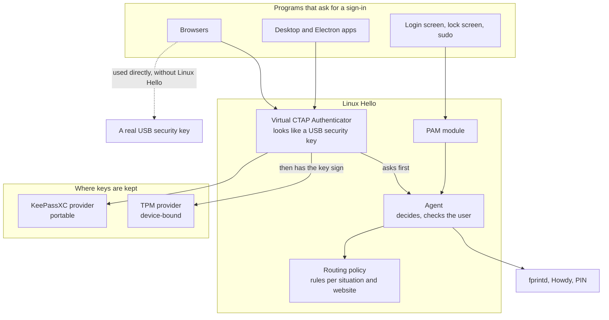

# 4. Solution strategy

Part of the [Arc42 architecture documentation](README.md).

This section gives the few big ideas that the rest of the design follows, and the reasons for them. [Section 1](01-introduction-and-goals.md) says what Linux Hello must do, [section 2](02-constraints.md) what it may not do, and [section 3](03-context-and-scope.md) which programs are around it. This section says how Linux Hello fits between them. [Section 5](05-building-block-view.md) then shows the parts that carry out these ideas. Terms that may be new to you are in the [glossary](12-glossary.md).

## 4.1 The idea in one paragraph

Linux Hello pretends to be a USB security key. Every browser already knows how to use one, so Linux Hello creates a security key in software through the kernel's [uhid](12-glossary.md#uhid) interface, and Firefox, Chromium and desktop apps use it without any change ([ADR-0005](../adr/0005-provider-path.md)). Behind that virtual key sits one central service, the [Agent](12-glossary.md#agent). It decides whether a request is allowed, asks the user for a fingerprint, the face or the PIN, and has the passkey signed where its private key is kept: in the [TPM](12-glossary.md#tpm-tpm-20), the computer's security chip, or in the password manager [KeePassXC](12-glossary.md#keepassxc). The same Agent answers the login screen, the lock screen and `sudo`, so the user meets one way of signing in everywhere.

## 4.2 Five layers

The design is easiest to follow as five layers, each with one job. A request travels down through them: something asks for a sign-in, the user is checked, the request is judged against the rules, and a key store signs.

| Layer | Its job | Who does it |
| :-- | :-- | :-- |
| 1. Interfaces | Receive requests from the outside: passkey requests from browsers and apps, and sign-in requests from the login screen, the lock screen and `sudo`. | The Virtual CTAP Authenticator for passkeys; the PAM module for signing in to the computer |
| 2. Unlock | Check the user with the face, a fingerprint or the PIN, and ask again when the rules say so. | The Agent, which runs fprintd, Howdy and the PIN check ([ADR-0023](../adr/0023-pam-module-and-login-failure.md)) |
| 3. Broker | Be the one place that decides, and have a key sign without ever handing the key out. | The Agent decides; the Virtual CTAP Authenticator then passes the request to the key store the Agent named |
| 4. Routing policy | Say, for each situation and each website, which methods are allowed, where the passkey is kept and how strong the prompt must be. | Policy files read by the Agent ([section 8, Policy](08-crosscutting-concepts.md#policy)) |
| 5. Providers | Keep the private keys and sign with them. | The TPM provider for keys that never leave the computer; the KeePassXC provider for keys the user can copy to other computers |

The diagram shows the same layers as boxes. Read it from top to bottom: the programs that ask, then Linux Hello's parts, then the key stores.

Notice that every request reaches the Agent before anything is signed: the PAM module asks it directly, and the virtual key asks it first and only then passes the request to the key store the Agent named. A real USB security key is drawn outside Linux Hello: browsers keep using it directly, as before, and Linux Hello neither routes to it nor replaces it.

## 4.3 Design rules

Five rules guide every decision. Each says what the rule is, why, and what it prevents.

1. **Keys sign; they never leave.** A passkey's private key stays in the TPM or in KeePassXC. Linux Hello asks the key store to sign a challenge and passes on only the signature. *Why:* a key that is never handed out cannot be stolen from a program's memory or copied to another machine. A login token that a website returns after the sign-in belongs to the app that asked for it; Linux Hello does not store it.
2. **A check unlocks the use of a key, never the key.** A fingerprint or face match allows the Agent to have the key sign; it never reveals key material to anyone. *Why:* if a match released the key, one successful attack on the face check would give away every passkey for good, instead of one sign-in.
3. **The owner of the computer chooses where keys live.** The routing policy decides per website whether its passkey is kept in the TPM or in KeePassXC. By default every website gets the TPM, and an administrator can name websites that may use KeePassXC ([policy semantics](https://github.com/LinuxHello/linux-hello/blob/main/docs/architecture/policy-semantics.md)). *Example:* a bank's website is held to the TPM, so its passkey can never be copied, while a forum's passkey may live in KeePassXC and travel to the user's laptop.
4. **One path for every app.** Browsers, desktop apps and Electron apps all reach Linux Hello through the same virtual security key. *Why:* stock Firefox and Chromium already talk to USB security keys, while neither calls the Linux credentials portal ([spike 0006](../spikes/0006-browser-webauthn-portal.md)), so no browser change and no extension is needed ([ADR-0017](../adr/0017-browser-path.md)). An experiment showed that passkeys a website finds without a user name, the user-verification check and a confirmation prompt all work through this path with stock browsers ([spike 0120](../spikes/0120-resident-keys-presence-and-uv.md)). *The price:* a browser shows Linux Hello as "a security key", not as "this device", and [ADR-0020](../adr/0020-presence-and-verification.md) has to define when the virtual key reports that the user was present and verified.
5. **Respect short token lifetimes.** When a service makes its login expire quickly, Linux Hello does not try to make the login last longer. It aims to make signing in again invisible or one touch. *Why:* the lifetime is the service's own security choice, and no program on the computer can extend it (see [4.4](#44-signing-in-again-without-the-user)).

## 4.4 Signing in again without the user

**The problem.** Some desktop apps sign in through a web page and receive a login token that expires within a day. The case that started this was Claude Desktop on KDE: it asked for a new login every day although its token was stored in [KWallet](12-glossary.md#kwallet), because the service itself limits the token's lifetime ([section 1](01-introduction-and-goals.md#12-requirements-overview), requirement 7). The cause was observed on one machine, not measured.

**The aim** is that the app gets a new token without the user doing anything, or with one touch at most.

- **Later: tokens tied to the device.** [DBSC](12-glossary.md#dbsc) (Device Bound Session Credentials), a draft web standard tried out in Chrome, ties a short-lived token to a key that never leaves the device, and the browser renews the token in the background by signing with that key. A key in the TPM would fit that role. It needs the service to support DBSC and a way for Linux Hello to supply the key; neither exists yet. Not built.
- **Until then: one touch.** The app's login page still opens, but it asks for a passkey; the user touches the fingerprint sensor once, the Agent has the key sign, and the app receives its token as before. This follows from the passkey path in 4.3 and needs nothing extra.

## 4.5 Why this approach

Several other ways to bring passkeys to the Linux desktop were considered. The table compares them; the first row is the chosen one.

| Approach | What it gives | Why it was not chosen, or what it costs |
| :-- | :-- | :-- |
| **A virtual security key in front of the TPM and KeePassXC (chosen, [ADR-0005](../adr/0005-provider-path.md))** | Works with stock browsers and apps today; one check for everything; the owner chooses where each website's key lives; no wait for another project | Browsers see a security key, not "this device"; a small helper program needs the right to create devices and must be confined ([spike 0121](../spikes/0121-uhid-helper-privilege.md)); Linux Hello writes its own CTAP handling |
| Build on credentialsd, a proposed Linux passkey service with a desktop portal | Would cover every app and reuse another project's protocol code | credentialsd has no way to plug in another key store ([spike 0005](../spikes/0005-credentialsd-provider-api.md)); no browser calls the portal ([spike 0006](../spikes/0006-browser-webauthn-portal.md)); Linux Hello would wait for that project's releases |
| KeePassXC with its browser extension only | Works today; keys can be copied to other computers | Browsers only, not desktop apps; keys in software, protected by a master password rather than the TPM |
| tpm-fido as it is, a virtual USB security key backed by the TPM | Works with any program that speaks to security keys; keys stay in the TPM | No fingerprint or face check; no portable keys. Linux Hello builds the same mechanism and adds both |
| A hardware security key only | Mature, and the strongest protection of the key | A separate device to carry; no fingerprint or face; no copy to another computer |

### Prior art

Other projects already tried parts of this. The facts below were taken from search results on 2026-10-27; the repositories themselves were not opened, and tpm-fido was not checked again.

| Project | What it does | State then | What Linux Hello takes from it |
| :-- | :-- | :-- | :-- |
| [kpasskey](https://github.com/Tojori/kpasskey) | Keeps passkeys in KWallet and offers them to unmodified Firefox and Chromium as a virtual security key | Prototype | The closest example of the chosen approach; its keys are in software and it serves browsers only |
| tpm-fido | A virtual USB security key backed by the TPM | Not checked again | Shows that TPM-backed keys behind a virtual device work |
| [Credentials for Linux](https://github.com/linux-credentials): libwebauthn and [credentialsd](https://github.com/linux-credentials/credentialsd) | A passkey library, and a D-Bus portal through which apps ask for passkeys | credentialsd v0.3.1, a pre-release of 7 September 2026, needing a patched desktop portal | Not used ([ADR-0005](../adr/0005-provider-path.md)); kept as a reference and as a possible later way to appear as "this device" |
| KeePassXC, version 2.7.7 and later | Stores passkeys in its database and offers them through its browser extension | Released | Used as the portable key store, behind the virtual security key |

Sources: the [FOSDEM 2026 talk on Credentials for Linux](https://archive.fosdem.org/2026/schedule/event/838A8N-credentials-for-linux-bringing-passkeys-to-linux/) and [its slides](https://archive.fosdem.org/2026/events/attachments/838A8N-credentials-for-linux-bringing-passkeys-to-linux/slides/267430/fosdem_ravbuub.pdf), and [freedom-browser issue #733](https://github.com/solardev-xyz/freedom-browser/issues/733).

## 4.6 What this strategy makes easier and harder

**Easier.** One check unlocks passkeys everywhere. No other project stands on the critical path. Websites that matter can be held to keys that never leave the computer. Desktop and Electron apps can use passkeys, not only browsers. An administrator can set rules as on Windows: PIN length, which methods each situation allows. And the way to tokens tied to the device (DBSC) stays open.

**Harder.**

- A new service that everything depends on has to be run, confined and watched ([section 7](07-deployment-view.md)).
- The rules for each situation and website have to be kept up to date.
- Keys in the TPM are lost when the TPM is cleared or the PIN is reset; the user then registers a new passkey with each website ([ADR-0003](../adr/0003-destructive-reset.md)).
- The helper that creates the virtual key needs a privilege that has to be confined.
- Browsers treat Linux Hello as a security key, not as part of the computer.
- Howdy shows no live camera picture ([spike 0008](../spikes/0008-howdy-interface.md)), and KDE has no place for Linux Hello's prompt or for entries on its Users page ([spike 0009](../spikes/0009-plasma-prompt-component.md), [spike 0010](../spikes/0010-kcm-users-extension-point.md)), so Linux Hello ships components of its own or waits for changes in KDE.

The first strategy, in October 2026, was a broker behind credentialsd's portal. Spikes 0005 and 0006 showed that neither credentialsd nor the browsers offered what it needed, and [ADR-0005](../adr/0005-provider-path.md) replaced it with the virtual security key on 2026-11-08.
