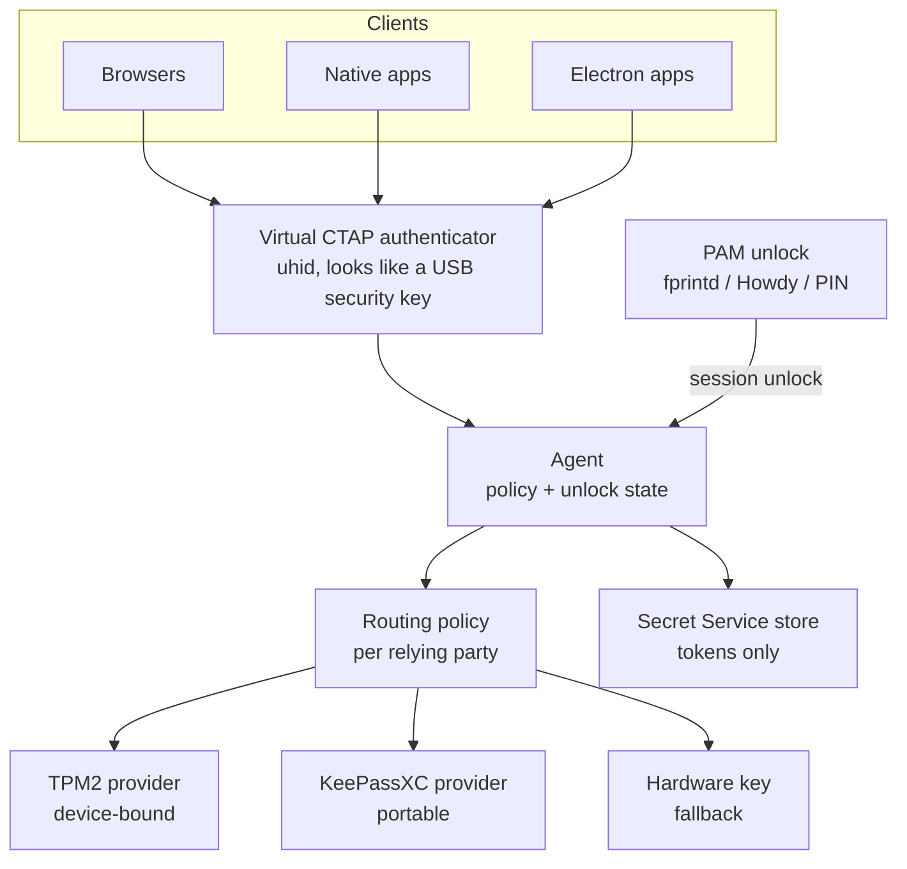

# 4. Solution strategy

Part of the [Arc42 architecture documentation](README.md).

## Layers

| Layer | Responsibility | Candidate components |
| :-- | :-- | :-- |
| 1. Unlock | One biometric/PIN verification per session; re-prompt per policy | PAM, `fprintd`, Howdy, PIN |
| 2. Broker | Single policy point; signs WebAuthn assertions; never exports private keys | The Agent and the Virtual CTAP Authenticator ([ADR-0005](../adr/0005-provider-path.md)) |
| 3. Interfaces | CTAP2 over a virtual USB security key (`uhid`) for WebAuthn; Secret Service API on D-Bus for tokens | Virtual CTAP Authenticator |
| 4. Routing policy | Per context and relying party: methods, provider, prompt level | Declarative policy files |
| 5. Providers | Hold keys | TPM2 (device-bound), KeePassXC (portable/synced), hardware security key (fallback) |

## Diagram

## Design rules

1. **Keys sign; stores keep secrets.** Passkey private keys stay in the TPM or KeePassXC and are used by the broker to sign. The Secret Service holds only resulting tokens, never passkey private keys.
2. **Unlock gates use, never release.** Biometric verification unlocks a key's use. It never hands key material to a caller.
3. **Operator chooses custody.** The routing policy decides TPM vs KeePassXC per relying party; the default for high-value accounts is TPM.
4. **One path for all clients.** Browsers, native and Electron apps reach Linux Hello through the same virtual CTAP authenticator, which stock Firefox and Chromium already talk to as a USB security key ([ADR-0005](../adr/0005-provider-path.md) option B, [ADR-0017](../adr/0017-browser-path.md)). They see a roaming key, not a platform authenticator. There is no browser extension in 1.0; neither browser calls the credentials portal ([spike 0006](../spikes/0006-browser-webauthn-portal.md)). Before release the device must get resident keys, user verification and a presence prompt ([spike 0094](../spikes/0094-virtual-ctap-end-to-end.md)).
5. **Short token lifetimes are respected.** The aim is invisible reissue, not longer tokens.

## Token reissue (the Claude Desktop case)

- **Target:** Device Bound Session Credentials (W3C draft DBSC, piloted in Chrome). A TPM-bound key proves the device, and short-lived tokens are refreshed silently. Requires provider support.
- **Interim:** keep the browser re-login, but make it one touch. The OAuth login page asks for a passkey, the broker signs after one fingerprint, and the token lands in the Secret Service.

## Prior art (checked 2026-10-27)

[ADR-0005](../adr/0005-provider-path.md) (2026-11-08) chooses a virtual CTAP authenticator and does not build on credentialsd, so that Linux Hello can be tried end to end without waiting for an upstream maintainer. kpasskey and tpm-fido show that the approach works with stock browsers; the gaps Linux Hello fills are the TPM provider with a PIN-rooted unlock, a KeePassXC provider, the biometric gate and the prompts. credentialsd stays a reference and a possible later platform-authenticator path.

| Project | What it does | State | Fit |
| :-- | :-- | :-- | :-- |
| [Credentials for Linux](https://github.com/linux-credentials) — libwebauthn + [credentialsd](https://github.com/linux-credentials/credentialsd) | FIDO2 platform library; D-Bus credentials portal for apps (third-party provider API planned, not in v0.3.1, see spike 0005); reference GTK UI; Firefox add-on and patched Flatpak | v0.3.1 pre-release (7 Sep 2026); needs a patched xdg-desktop-portal; TPM provider planned, not built; packaged for Fedora/openSUSE | Layers 2–4. Not used on the provider path (ADR-0005) |
| [kpasskey](https://github.com/Tojori/kpasskey) | Passkeys stored in KWallet, exposed as a virtual CTAP 2.1 security key to unmodified Firefox and Chromium | Prototype | Closest prior art for the chosen approach; software keys, browsers only |
| tpm-fido | Virtual USB FIDO device backed by the TPM | Not re-checked in this pass | Prior art for TPM custody behind a virtual device |
| KeePassXC (≥ 2.7.7) | Passkeys in KDBX via browser extension | Released | Portable provider behind the virtual CTAP authenticator (ADR-0005 option B) |

Sources: [FOSDEM 2026 talk](https://archive.fosdem.org/2026/schedule/event/838A8N-credentials-for-linux-bringing-passkeys-to-linux/), [slides](https://archive.fosdem.org/2026/events/attachments/838A8N-credentials-for-linux-bringing-passkeys-to-linux/slides/267430/fosdem_ravbuub.pdf), [freedom-browser issue #733](https://github.com/solardev-xyz/freedom-browser/issues/733). Taken from search snippets; repositories not yet opened.

## Alternatives

| Option | Pros | Cons |
| :-- | :-- | :-- |
| **Virtual CTAP authenticator (chosen, ADR-0005 option B)** | Works with stock browsers and apps today; one unlock; per-RP custody choice; no upstream dependency | Browsers see a roaming key, not a platform authenticator; a privileged `uhid` helper; own CTAP handling |
| Session broker + portal on credentialsd (earlier recommendation) | Covers all clients; reuses upstream CTAP/WebAuthn work | No provider API (spike 0005); no browser calls the portal (spike 0006); critical path through upstream |
| KeePassXC + browser extension only | Works today; portable keys | Browsers only; software keys; master-password unlock |
| tpm-fido as it is (virtual USB FIDO device on TPM) | Works with any CTAP client today; TPM-bound | No biometric gate by default; no portable keys; Linux Hello builds the same mechanism with both |
| Hardware security key only | Mature, strongest custody | Separate device; no biometric unlock; no sync |

## Consequences

**Easier:** one unlock for passkeys and secrets; no upstream on the critical path; device-bound keys for high-value accounts; native and Electron apps join the passkey flow; enterprise-style policy (PIN complexity, allowed methods per context); a clean path to DBSC.

**Harder:** a new trust-critical daemon to operate, confine and monitor; policy must be maintained per context and relying party; TPM-bound keys are lost if the TPM is cleared or the root key is reset (ADR-0003); a privileged `uhid` helper to confine; browsers treat the device as a roaming key; Howdy gives no preview (spike 0008) and KDE has no extension points for the prompt or the Users page (spikes 0009, 0010), so those need our own components or upstream changes.
