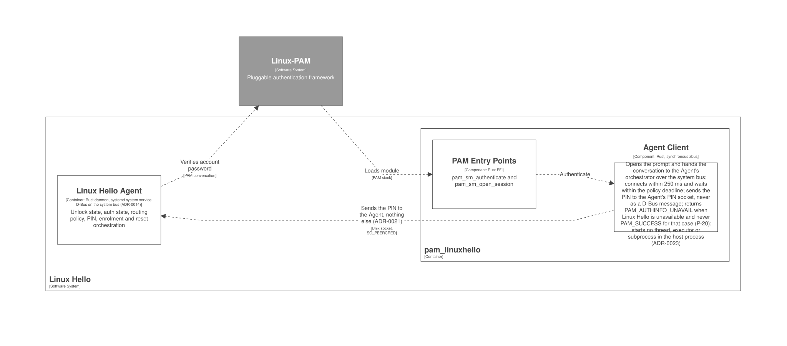
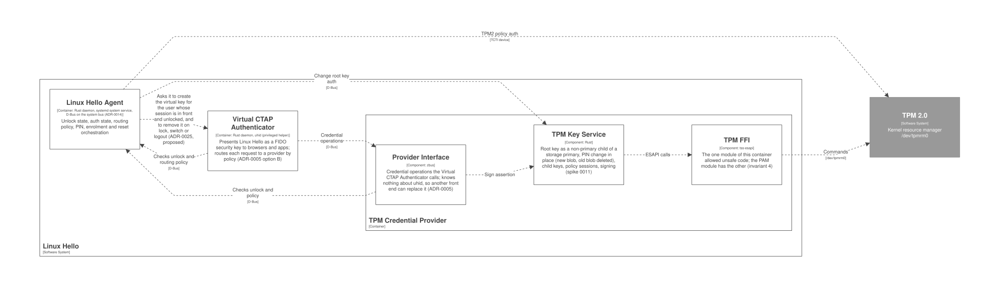
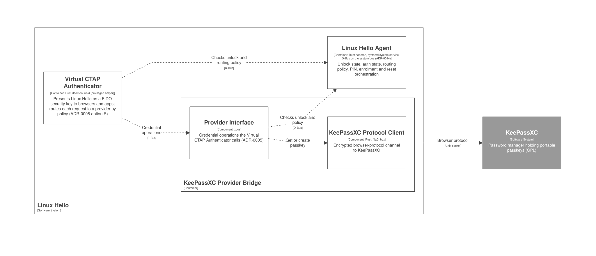
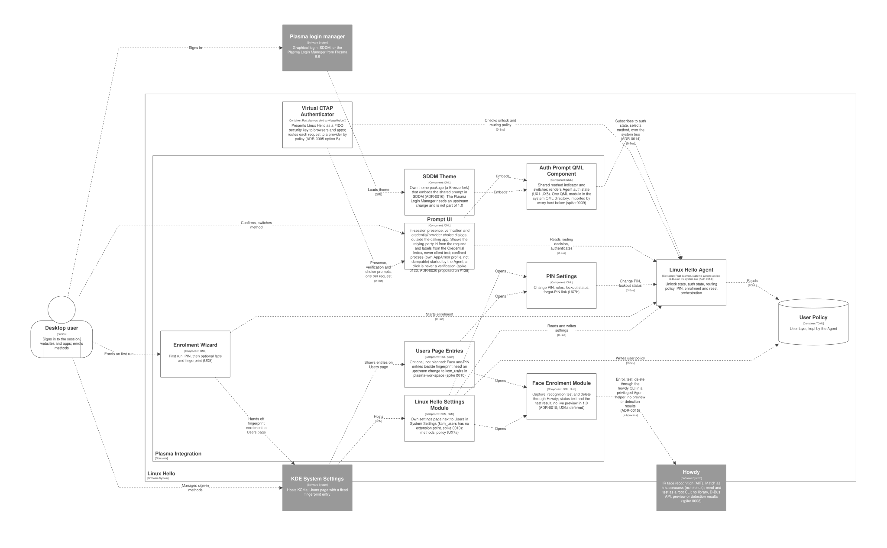
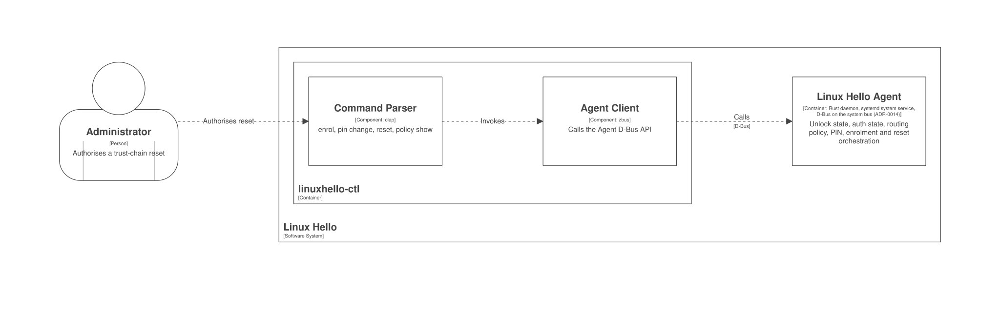
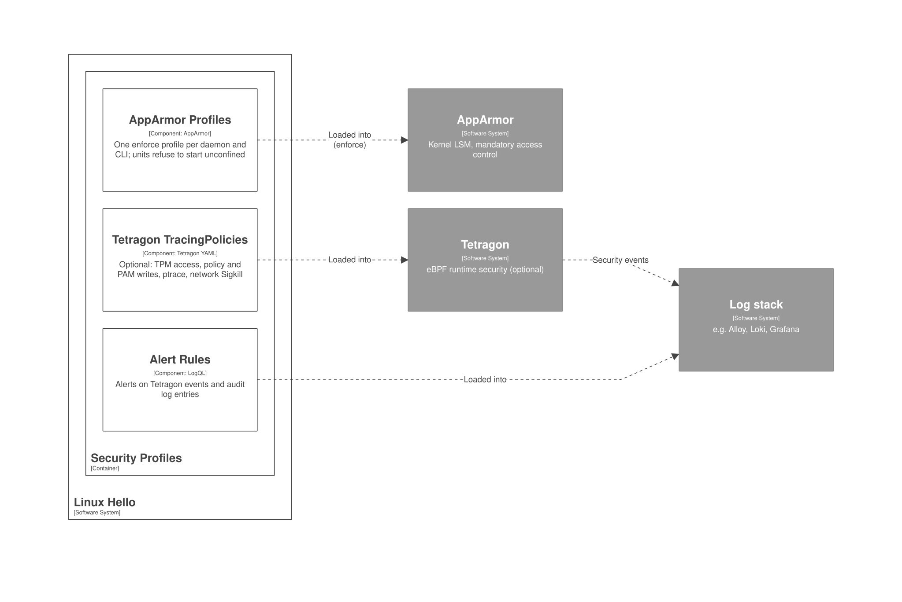

# 5. Building block view

Part of the [Arc42 architecture documentation](README.md).

This section answers the question: which parts is Linux Hello made of, what does each part do, and how do they talk to each other? [Section 3](03-context-and-scope.md) shows Linux Hello as one box among the programs around it, such as the browser, the login screen and the fingerprint service. This section opens that box. [Section 6](06-runtime-view.md) then follows the same parts at work, step by step. After reading this section you know every part by name, why it is a part of its own, and whether it exists today. Terms that may be new to you are in the [glossary](12-glossary.md).

## How this section is organised

The parts are described with the [C4 model](12-glossary.md#c4-model), a way to draw software at several levels of detail, like maps at different scales:

- A **container** is a part that runs or is stored on its own: a background service, a library that another program loads, a command-line tool, a set of files. It has nothing to do with Docker containers. [Section 5.1](#51-level-1-containers) describes the ten containers of Linux Hello.
- A **component** is a piece inside one container, such as the part of the Agent that checks a PIN. [Section 5.2](#52-level-2-components) shows the components of each container.
- The **code** is the lowest level. It is not drawn; [section 5.3](#53-level-3-code) says why.

The diagrams are not drawn by hand. They are generated from one text file, [workspace.dsl](../workspace.dsl), written in the language of the Structurizr tool ([how they are rendered](../diagrams/README.md)). Keeping one source means the diagrams cannot disagree with each other. The code names the container or component it implements in a comment, and the continuous integration of `linux-hello` checks that every name exists in that file (the script `scripts/ci/c4-docs.sh`, decided in [ADR-0008](../adr/0008-code-documentation-mapped-to-c4.md), which is still proposed).

References such as "ADR-0014" point to an [architecture decision record](12-glossary.md#adr), which gives the reasons for a decision; references such as "spike 0121" point to a [spike](12-glossary.md#spike), a short experiment that answered one question. The text always says what was decided or found first, so you can read on without following the link.

In the diagrams, a white box is a part of Linux Hello, a grey box is a program Linux Hello uses but does not ship, a person shape is a person, and a cylinder holds data. Each arrow says in words what one part asks of the other, and in brackets how, for example "D-Bus" or "subprocess".

Linux Hello does not sign anyone in yet. Most parts below are decided but not built. Each part therefore carries one of three marks: **built** (code exists and is tested), **code, not in use** (code exists and is tested, but nothing starts it yet), or **not built** (decided, no code yet). [What works today](01-introduction-and-goals.md#what-works-today) in section 1 gives the overview.

## 5.1 Level 1: containers

Linux Hello lets a person sign in to the computer, and to websites with [passkeys](12-glossary.md#passkey) (sign-in keys that replace passwords), using their face, their fingerprint or a PIN. The keys are kept by the [Trusted Platform Module (TPM)](12-glossary.md#tpm-tpm-20), a security chip in the computer from which no program can copy a key.

Linux Hello has one central service, the Agent, and every other part either asks the Agent or serves it. The reason is that one place must hold the decisions that matter for security: who may sign in, with which method, and when the TPM may use a key. If each part decided on its own, a flaw in any one of them, for instance in the library that the login screen loads, could open the door.

The diagram below shows the ten containers inside the large box "Linux Hello", and the outside programs and people they talk to. Start at the Agent and follow the arrows that end there.

Notice that almost every arrow from a Linux Hello part ends at the Agent, and that only the Agent and the TPM provider reach the TPM. The diagram is wide because the layout is automatic; open the image on its own to zoom.

The table lists the containers so that you can look one up. The subsections after it explain each one.

| Container | What it is, in one sentence | State |
| :-- | :-- | :-- |
| [Linux Hello Agent](#linux-hello-agent) | The central background service that decides, keeps the state of every sign-in attempt, and alone checks the PIN against the TPM | Partly built |
| [`pam_linuxhello`](#pam_linuxhello-the-pam-module) | The small library that the login screen, the lock screen and `sudo` load to ask the Agent whether a user may sign in | Not built (its configuration snippets are built) |
| [Virtual CTAP Authenticator](#virtual-ctap-authenticator) | The service that makes Linux Hello look like a USB security key to browsers and apps | Not built (tested as experiments) |
| [TPM Credential Provider](#tpm-credential-provider) | Creates and uses passkeys whose private keys never leave the TPM | Not built |
| [KeePassXC Provider Bridge](#keepassxc-provider-bridge) | Fetches passkeys that are kept in the password manager KeePassXC | Not built |
| [Plasma Integration](#plasma-integration) | Everything the user sees in KDE Plasma: the sign-in prompt, the passkey window, the login screen theme and the settings | Not built |
| [`linuxhello-ctl`](#linuxhello-ctl) | A command-line tool for the user and the administrator | Partly built |
| [User Policy](#user-policy-and-admin-policy) | One file per user with the rules that user chose | Built |
| [Admin Policy](#user-policy-and-admin-policy) | Files with the rules the administrator set, which win over the user's | Built |
| [Security Profiles](#security-profiles) | The rules that confine each Linux Hello program and watch for attacks | Partly built |

### Linux Hello Agent

**What it is.** A background service that runs for the whole computer, not for one user: a *systemd system service* that starts when the computer starts, runs as its own user `linuxhello`, and is reached over the D-Bus *system bus*, the message channel that programs of every user and of the system share ([ADR-0014](../adr/0014-agent-bus.md)). Its name on the bus is `io.github.LinuxHello.Agent1` ([ADR-0012](../adr/0012-dbus-names.md)).

**What it does.** It keeps a record of every sign-in attempt (a [prompt](12-glossary.md#prompt)) and tells the login screen which method is running and whether it succeeded. It holds the [routing policy](12-glossary.md#policy-routing-policy), the rules that say which methods and which passkey store are allowed where. It runs fingerprint, face and PIN at the same time when a user signs in, and lets the first success win ([ADR-0023](../adr/0023-pam-module-and-login-failure.md)). It is the only program that checks a PIN against the TPM, and it receives the PIN on a socket of its own, never as a D-Bus message, so that the bus daemon never sees it ([ADR-0021](../adr/0021-pin-transport.md)). It also guides the first setup and the [destructive reset](12-glossary.md#destructive-reset) after a forgotten PIN ([ADR-0003](../adr/0003-destructive-reset.md)).

**Why a system service and not one per user.** The login screen runs before any user has signed in, so a per-user service would not exist yet when it is needed most ([ADR-0014](../adr/0014-agent-bus.md)).

**State: partly built.** Built and tested: the calls that open, follow and close a prompt and the signals that report it; the bus policy, the systemd unit with its watchdog and the [AppArmor](12-glossary.md#apparmor) profile (the list of files and devices the kernel lets the Agent touch), tested on Ubuntu 24.04 and 26.04 ([section 7](07-deployment-view.md)); the policy engine and the user's own policy layer; the audit log. Code, not in use: the PIN socket and the per-user counter of wrong PINs. Not built: running the methods, the TPM, setup and reset.

### pam_linuxhello, the PAM module

**What it is.** A shared library that Linux-PAM loads. *PAM* is the framework through which every Linux program that signs a user in, such as the login screen, the lock screen or `sudo`, asks "is this the right person?". Each of those programs reads a list of modules from `/etc/pam.d/` and asks them in turn. `pam_linuxhello` is Linux Hello's entry in that list. It is written in Rust and built as a library that C programs can load (a Rust `cdylib`).

**What it does.** Very little, on purpose. It asks the Agent to open a prompt for the user, hands the conversation over to the Agent, waits for the answer with a hard time limit and turns the answer into a PAM return code. If the user types a PIN, it sends the PIN to the Agent's PIN socket ([ADR-0021](../adr/0021-pin-transport.md)).

**Why so thin.** The module runs inside other programs, some of them running as root. A crash or a hang there would crash or freeze the login screen. So the module starts no thread and no subprocess, gives up if it cannot reach the Agent within 250 milliseconds, and then answers `PAM_AUTHINFO_UNAVAIL`, which means "I cannot decide". PAM then moves on to the next module, `pam_unix`, which asks for the account password. A broken Linux Hello therefore never locks a user out, and its failure never counts as a successful sign-in ([ADR-0023](../adr/0023-pam-module-and-login-failure.md); walkthrough [6.2](06-runtime-view.md#62-signing-in-when-linux-hello-is-not-working)).

**State: not built** ([linux-hello#196](https://github.com/LinuxHello/linux-hello/issues/196)). The configuration snippets for `login`, `sudo` and the lock screen, which place the module before `pam_unix`, are built and tested.

### Virtual CTAP Authenticator

**What it is.** A service that creates a security key in software. Browsers already know how to sign in with a USB security key: they speak [CTAP](12-glossary.md#ctap-ctap2), the Client to Authenticator Protocol, to it over a [HID](12-glossary.md#hid) device, the kind of device a keyboard or a key is. Linux offers `/dev/uhid`, through which a program can create such a device without hardware. The Virtual CTAP Authenticator uses it, so that Firefox, Chromium and desktop apps see one more security key and need no change and no extension ([ADR-0005](../adr/0005-provider-path.md), [ADR-0017](../adr/0017-browser-path.md)).

**What it does.** It receives each request from the browser, such as "sign in to github.com", asks the Agent whether the request is allowed and which passkey store to use, asks the user to confirm in the Prompt UI, and passes the request to one of the two *providers* below. It holds no keys itself.

**Why it is split.** Only a small helper program opens `/dev/uhid`, because a program that can create HID devices could also create a fake keyboard and type into the user's session. The helper runs as its own user, may open `/dev/uhid` through one rule for [udev](12-glossary.md#udev), the service that decides who may open a device file, instead of being root, has no access to the TPM or to the user's files, and is confined by AppArmor ([spike 0121](../spikes/0121-uhid-helper-privilege.md)). A second experiment showed how one virtual key can belong to exactly one user and exist only while that user's session is active and unlocked ([spike 0138](../spikes/0138-virtual-ctap-session-binding.md)); no ADR records that yet.

**State: not built.** Experiments with a prototype showed that stock Firefox and Chromium create and use passkeys through such a key, including passkeys the site finds without a user name ([spike 0120](../spikes/0120-resident-keys-presence-and-uv.md)). The model has no component view for this container yet.

### TPM Credential Provider

**What it is.** A service that creates and uses *device-bound* passkeys: passkeys whose private key is made inside the TPM, the security chip of the computer, and can never be copied out of it.

**What it does.** For each website it creates a key under the user's [root key](12-glossary.md#root-key), the key that the user's PIN unlocks. To sign in, it asks the TPM to sign with that key. The TPM refuses a key of one website for a request of another, so even a bug in Linux Hello cannot sign for the wrong site ([spike 0119](../spikes/0119-rp-bound-credential-keys.md)).

**State: not built.** One open question blocks it: how a fingerprint or face match is tied to the TPM, since the TPM only knows the PIN ([linux-hello#136](https://github.com/LinuxHello/linux-hello/issues/136)).

### KeePassXC Provider Bridge

**What it is.** A service that serves *portable* passkeys: passkeys kept in the password manager KeePassXC, which the user can copy to another computer, unlike the device-bound ones above.

**What it does.** It asks KeePassXC for a passkey, or to store a new one, over KeePassXC's own browser protocol, an encrypted channel on a local socket.

**State: not built.**

### Plasma Integration

**What it is.** Everything of Linux Hello that the user sees, built for the KDE Plasma desktop with QML, Qt's language for user interfaces, and Rust.

**What it does.** It shows the sign-in prompt with the method in use, in a login screen theme for SDDM, the login screen of Plasma ([ADR-0016](../adr/0016-prompt-hosts.md)). It shows the Prompt UI, the window that asks the user to confirm a passkey ([ADR-0020](../adr/0020-presence-and-verification.md)). It offers a settings page in System Settings, the first-run setup and face enrolment through [Howdy](12-glossary.md#howdy), the Linux face-recognition program, without a live camera picture ([ADR-0015](../adr/0015-face-capture-and-enrolment.md)). The lock screen needs none of this: KDE's own lock screen already asks PAM for a face and a fingerprint, and Linux Hello uses it as it is ([ADR-0016](../adr/0016-prompt-hosts.md)).

**State: not built.**

### linuxhello-ctl

**What it is.** A command-line tool.

**What it does.** Today it gives the administrator four commands that read the policy files on disk directly and need no running Agent, so that root can repair a broken policy even when the Agent cannot start: `policy show` and `policy reset` for one user's layer, and `status` and `doctor`, which say in words what is wrong with the policy files. Later it gets setup, PIN change and the reset.

**State: partly built.** The four commands are built and tested. Setup, PIN change, reset and every call to the Agent are not built.

### User Policy and Admin Policy

**What they are.** Two kinds of text file in [TOML](12-glossary.md#toml), a simple format for settings, that hold the rules of the routing policy.

The **user layer** holds what one user chose, for example a longer minimum length for their PIN (`min_length` under `[pin]`). It lives in `/var/lib/linuxhello/users/<uid>/policy.toml`, where only the Agent can write; the user changes it through the Agent's calls `GetUserPolicy` and `SetUserPolicy`. A user can only make the rules stricter than the defaults, never weaker ([ADR-0018](../adr/0018-user-policy-layer.md)).

The **admin layer** holds what the administrator set, in `/etc/linuxhello/policy.d/*.toml`, owned by root. A rule set there wins over the user's and is shown as "Managed by your organisation". Later a device-management system could deliver these files, as Microsoft's Intune does for Windows Hello.

If a file cannot be trusted, for example because it does not parse, the Agent falls back to the [PIN-only state](12-glossary.md#pin-only-state), in which only the PIN works. [Section 8](08-crosscutting-concepts.md#policy) explains the layers and their order in full.

**State: built.** Both layers are read, merged and tested; nothing yet acts on the result, because the parts that would ask are not built.

### Security Profiles

**What they are.** The rules shipped with Linux Hello that limit what each of its programs may do, and that watch for attacks.

**What they do.** An AppArmor profile per program lists the files, devices and sockets it may use, and the kernel refuses everything else; the Agent's unit refuses to start without its profile loaded. Optional policies for [Tetragon](12-glossary.md#tetragon), a monitor that watches the kernel, report suspicious actions such as another program opening the TPM, and alert rules turn those events and the audit log into alerts.

**State: partly built.** The Agent's AppArmor profile is built and tested on Ubuntu 24.04 and 26.04. The profiles of the other programs, the Tetragon policies and the alert rules are not built.

### Where each container lives in the code

| Container | Path in [linux-hello](https://github.com/LinuxHello/linux-hello) |
| :-- | :-- |
| Linux Hello Agent | `crates/linuxhello-agent` |
| `pam_linuxhello` | `crates/pam-linuxhello` (the PAM snippets are in its `pam.d/` folder) |
| Virtual CTAP Authenticator | none yet |
| TPM Credential Provider | `crates/linuxhello-tpm-provider` (a skeleton) |
| KeePassXC Provider Bridge | `crates/linuxhello-kpxc-bridge` (a skeleton) |
| Plasma Integration | `plasma/` (a placeholder) |
| `linuxhello-ctl` | `crates/linuxhello-ctl` |
| User Policy, Admin Policy | written by the Agent and the administrator; an example is `policy/policy.example.toml` |
| Security Profiles | `security/` |

One more crate, `crates/linuxhello-dbus`, is not a container: it holds the names and messages of the Agent's D-Bus interface and is linked into every program that calls the Agent, so that caller and Agent cannot disagree about them.

## 5.2 Level 2: components

This level opens each container and shows the pieces inside it. Each subsection has one diagram, generated from [workspace.dsl](../workspace.dsl), and a table that says what each piece does and whether it is built. The diagrams also show the outside programs and the other containers that each piece talks to. The Virtual CTAP Authenticator, the User Policy and the Admin Policy have no components in the model.

### Agent

The diagram shows the pieces of the Agent, the Linux Hello parts that call it, and the outside programs it uses: the TPM, fprintd, Howdy, Linux-PAM and the system journal.

Notice that only two pieces receive anything from outside the Agent: the D-Bus API and the PIN Socket. Every request passes one of them, and both check who the caller is before anything else.

| Component | What it does | State |
| :-- | :-- | :-- |
| D-Bus API | Receives every call on the bus, reads the caller's user number from the bus itself and refuses a caller it cannot identify, and keeps the state per user so that no answer names another user ([ADR-0014](../adr/0014-agent-bus.md)). | Built |
| Auth State Publisher | Tells the program that opened a prompt which methods are available, which ones are running, and the result with its reason and the seconds to wait, by the signals `MethodsAvailable`, `ActiveMethods`, `State`, `Result` and `Closed`. | Built |
| Routing Policy Engine | Merges the defaults, the user layer and the admin layer and answers which methods and which provider are allowed for a sign-in, a website or a `sudo` call. Falls back to the PIN-only state when a file cannot be trusted. | Built; no call answers from it yet |
| Audit Logger | Writes one entry to the system journal for every refused request and every change of a user's policy. A PIN or a text the caller sent can never reach it. | Built |
| PIN Socket | A local socket of the Agent that accepts one thing, a PIN, and asks the kernel which user and process sent it (with [`SO_PEERCRED`](12-glossary.md#so_peercred)), so a sender cannot lie about who it is ([ADR-0021](../adr/0021-pin-transport.md)). | Code, not in use |
| PIN Verifier | Stretches the PIN with a slow key derivation and offers it to the TPM to unlock the root key, over an encrypted session so that the PIN cannot be read on the way to the chip. Counts wrong PINs per user before the TPM's own counter, which is shared by all users, would lock everyone out. | The counter of wrong PINs: code, not in use. The rest: not built |
| Method Orchestrator | Runs fingerprint, face and PIN at the same time for one prompt; the first success wins and the others are cancelled ([ADR-0023](../adr/0023-pam-module-and-login-failure.md)). | Not built |
| Fingerprint Client | Asks fprintd, the Linux fingerprint service, to check a finger. | Not built |
| Face Client | Runs Howdy, the Linux face-recognition program, and reads its answer from its exit status. | Not built |
| Unlock State Manager | Keeps whether the user's keys are unlocked, and for how long, proven by the TPM rather than by a flag in memory. | Not built |
| PIN Manager | Changes the PIN and applies the PIN rules, such as the minimum length. | Not built |
| Enrolment Orchestrator | Leads the first setup: choose a PIN, create the root key, then offer face and fingerprint. | Not built |
| Reset Coordinator | Carries out the destructive reset after a forgotten PIN, after checking the account password ([ADR-0003](../adr/0003-destructive-reset.md)). | Not built |

The Agent also tells systemd at regular intervals that it is still answering (a [watchdog](12-glossary.md#watchdog)), so that systemd restarts it if it hangs. This is built; it belongs to how the Agent runs, not to a component.

### PAM

The diagram shows the two pieces of the PAM module, between Linux-PAM on one side and the Agent on the other.

Notice that the Agent Client uses two channels: the bus for the prompt, the PIN socket for the PIN.

| Component | What it does | State |
| :-- | :-- | :-- |
| PAM Entry Points | The two functions PAM calls, `pam_sm_authenticate` and `pam_sm_open_session`. They need `unsafe` Rust, which the project allows only in one audited module here and one in the TPM provider (invariant 4 of [linux-hello's AGENTS.md](https://github.com/LinuxHello/linux-hello/blob/main/AGENTS.md)). | Not built |
| Agent Client | Opens the prompt, hands over the conversation, waits with the time limits, sends the PIN to the PIN socket and turns the result into a PAM return code. Never returns success when it could not reach the Agent. | Not built |

### TPM Provider

The diagram shows the four pieces of the TPM Credential Provider, from the interface the Virtual CTAP Authenticator calls down to the TPM.

Notice that the Provider Interface checks with the Agent before it signs anything, so the provider never decides alone.

| Component | What it does | State |
| :-- | :-- | :-- |
| Provider Interface | The calls the Virtual CTAP Authenticator makes: create a passkey, sign in with one. It knows nothing about `uhid`, so another front end could replace the authenticator ([ADR-0005](../adr/0005-provider-path.md)). | Not built |
| Credential Index | The list of passkeys a website can find without a user name ([discoverable credentials](12-glossary.md#discoverable-credential)): for each, the website, the user account, the provider and the TPM-wrapped key. It holds no private key. The model draws it here, beside the key service that uses it; its file is kept in the Agent's state directory ([spike 0120](../spikes/0120-resident-keys-presence-and-uv.md)). | Not built |
| TPM Key Service | Creates the root key and the keys for each website, changes the PIN without changing the keys, and signs ([spike 0011](../spikes/0011-tpm-root-key-change-auth.md)). | Not built |
| TPM FFI | The bridge to the TPM's C library; the one module of this container allowed to use `unsafe` Rust. | Not built |

### KeePassXC Bridge

The diagram shows the two pieces of the KeePassXC Provider Bridge.

Notice that the bridge offers the same Provider Interface as the TPM provider, so the authenticator treats both stores alike.

| Component | What it does | State |
| :-- | :-- | :-- |
| Provider Interface | The same calls as the TPM provider's interface. | Not built |
| KeePassXC Protocol Client | Talks to KeePassXC over its browser protocol, encrypted with NaCl, a small encryption library. | Not built |

### Plasma

The diagram shows the pieces of the Plasma Integration and the KDE programs that host them: the login screen, System Settings and the user.

Notice that one shared component, the Auth Prompt, is embedded wherever a prompt appears, so the login screen and the passkey window look and behave alike.

| Component | What it does | State |
| :-- | :-- | :-- |
| Auth Prompt QML Component | The method symbols and the switch between them, filled from the Agent's signals. One QML module that every host imports ([spike 0009](../spikes/0009-plasma-prompt-component.md)). | Not built |
| SDDM Theme | Linux Hello's own login screen theme, based on KDE's Breeze theme, that embeds the Auth Prompt ([ADR-0016](../adr/0016-prompt-hosts.md)). The newer Plasma Login Manager would need a change in KDE and is not part of version 1.0. | Not built |
| Prompt UI | The window that asks the user to confirm a passkey. It shows only the website's name as the request gives it and the labels Linux Hello stored, never text the app sent. The Agent starts it as a confined process that other programs cannot inspect, and a click on it never counts as proof of who the user is ([ADR-0020](../adr/0020-presence-and-verification.md)). | Not built |
| Linux Hello Settings Module | Linux Hello's own page in System Settings, next to the Users page, because the Users page has no place for other programs' entries ([spike 0010](../spikes/0010-kcm-users-extension-point.md)). | Not built |
| PIN Settings | Change the PIN, see the PIN rules and whether the PIN is locked, and the "forgot PIN" link. | Not built |
| Face Enrolment Module | Record a face, test it and delete it through Howdy; shows text and the test result, no live picture in version 1.0 ([ADR-0015](../adr/0015-face-capture-and-enrolment.md)). | Not built |
| Enrolment Wizard | The first-run setup: a PIN first, then face and fingerprint if the user wants them. Fingerprint enrolment is handed to KDE's Users page. | Not built |
| Users Page Entries | Face and PIN entries on KDE's Users page. Would need a change in KDE; optional and not planned. | Not planned |

### CLI

The diagram shows the two pieces of `linuxhello-ctl`.

Notice that the built commands do not use the Agent Client: they read the files on disk, so they work when the Agent does not.

| Component | What it does | State |
| :-- | :-- | :-- |
| Command Parser | Reads the command line. | Built for `policy show`, `policy reset`, `status` and `doctor` |
| Agent Client | Calls the Agent over the bus, for the commands that need a running Agent. | Not built |

### Security Profiles

The diagram shows the three kinds of rule that Linux Hello ships and the system programs that load them.

Notice that only the AppArmor profiles are needed to run Linux Hello; Tetragon and the log stack are optional.

| Component | What it does | State |
| :-- | :-- | :-- |
| AppArmor Profiles | One profile per program in enforce mode, so the kernel refuses whatever the profile does not list. | Built for the Agent; not built for the others |
| Tetragon TracingPolicies | Optional rules for Tetragon, a kernel-level monitor, that report access to the TPM, writes to the policy and PAM files, and one program inspecting another. | Not built |
| Alert Rules | Turn Tetragon's events and the audit log into alerts in a log system such as Grafana Loki. | Not built |

[Section 8](08-crosscutting-concepts.md#additions-to-the-c4-model) lists the components that the user-experience design added to the model.

## 5.3 Level 3: code

The code level is not drawn. Diagrams of single types and functions go out of date with every change, so instead every module and type in the code carries a comment that names the container or component it belongs to, and continuous integration checks those names ([ADR-0008](../adr/0008-code-documentation-mapped-to-c4.md)). To go from a box in a diagram to its code, search the code for the box's identifier in `workspace.dsl`, for example `pinSocket` for the PIN Socket. If class diagrams are ever wanted, the first candidates are the Routing Policy Engine and the TPM Key Service, the two pieces with the most rules.

## How the model got here

The model changed as experiments (spikes) answered questions. The table lists those changes, so that a reader who knew an earlier version can see what moved and why.

| What was learned | What changed in the model |
| :-- | :-- |
| credentialsd, a proposed Linux service for passkeys, offers no way for Linux Hello to plug in its own key store ([spike 0005](../spikes/0005-credentialsd-provider-api.md), [ADR-0005](../adr/0005-provider-path.md)). | credentialsd and the desktop portal were removed; the Virtual CTAP Authenticator and the kernel's `uhid` were added, and the providers are called by the authenticator. |
| Howdy can only be run as a program that answers with its exit status, and enrolled through a command that needs root; it has no library and no live picture ([spike 0008](../spikes/0008-howdy-interface.md)). | The Face Client and the Face Enrolment Module run Howdy as a program, and there is no live picture in version 1.0 ([ADR-0015](../adr/0015-face-capture-and-enrolment.md)). |
| Neither the login screen nor the lock screen has a slot for another program's prompt, but one QML module can be shared ([spike 0009](../spikes/0009-plasma-prompt-component.md)). | A login screen theme embeds the shared Auth Prompt, and the lock screen uses KDE's own face and fingerprint services, so it has no Linux Hello component ([ADR-0016](../adr/0016-prompt-hosts.md)). |
| KDE's Users page cannot take other programs' entries ([spike 0010](../spikes/0010-kcm-users-extension-point.md)). | Linux Hello has its own settings page; the Users Page Entries are optional and not planned. |
| The PIN of the root key can be changed in place if the root key is a child of another TPM key ([spike 0011](../spikes/0011-tpm-root-key-change-auth.md)). | The TPM Key Service is described that way. |
| The test camera does not reliably deliver the colour and the infrared picture at once ([spike 0012](../spikes/0012-camera-rgb-ir-concurrent.md)). | No camera component: Howdy alone holds the infrared camera while it checks a face. |
| Passkeys that a website finds without a user name, and the checks for presence and verification, work through a virtual key with stock browsers; one confirmation per request needs a special answer to the browser's first probe ([spike 0120](../spikes/0120-resident-keys-presence-and-uv.md)). | The Credential Index and the Prompt UI were added. |

An earlier design, a browser extension of Linux Hello's own ([ADR-0013](../adr/0013-browser-fallback.md), replaced by [ADR-0017](../adr/0017-browser-path.md)), is not in the model: browsers use the virtual security key and there is no extension.
