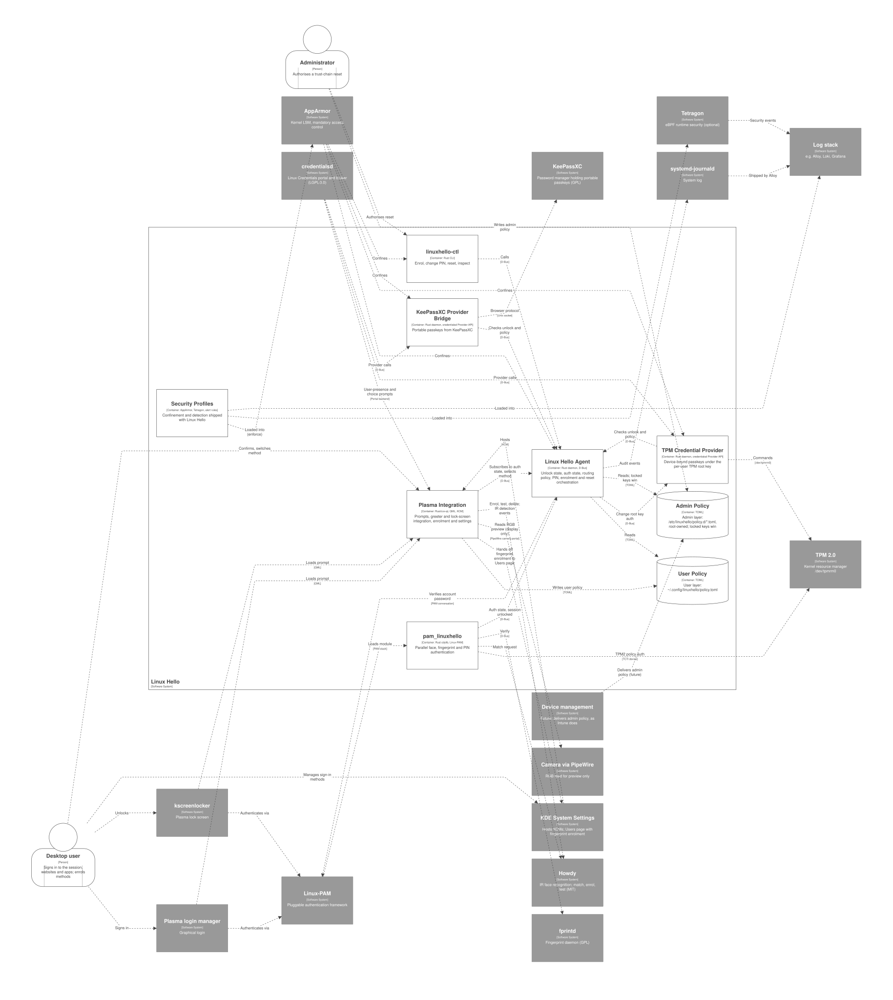
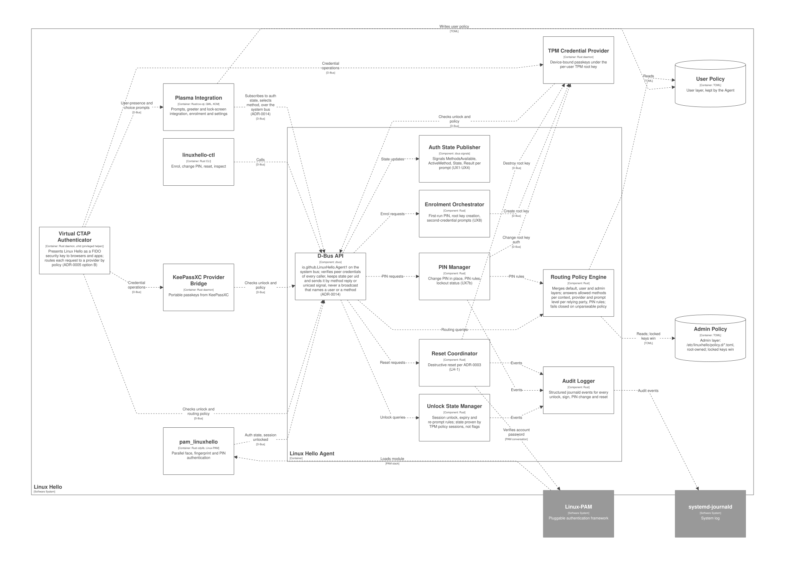
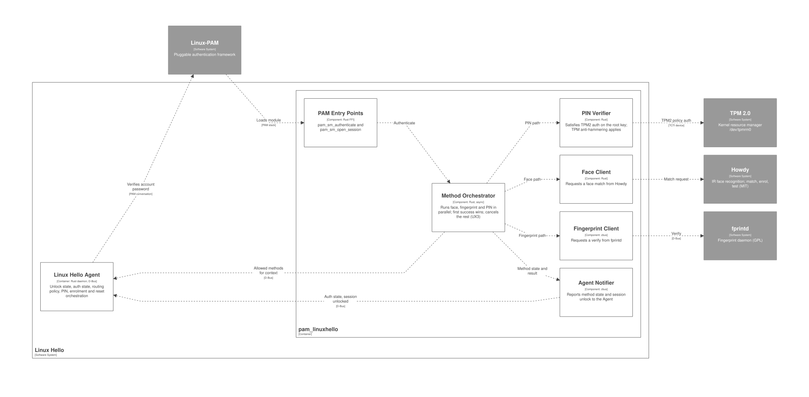
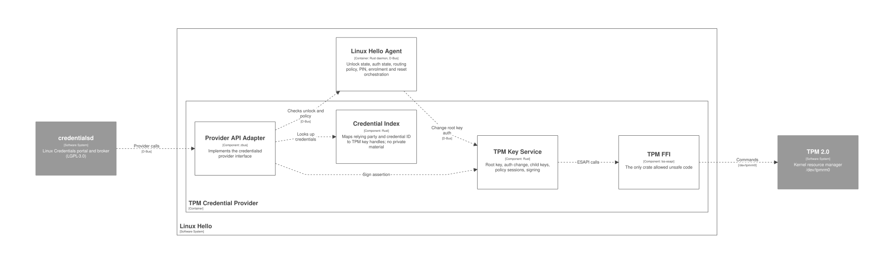
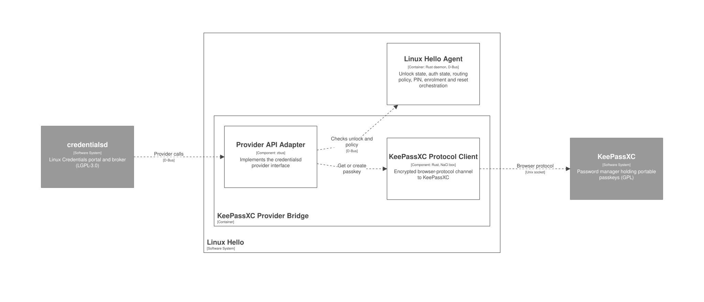
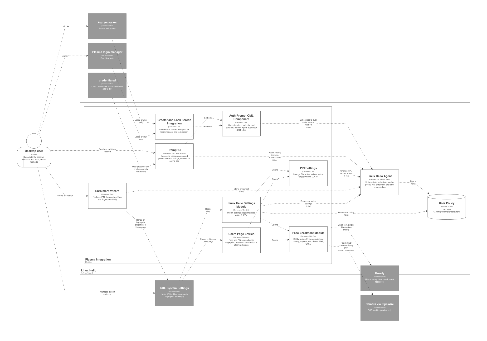
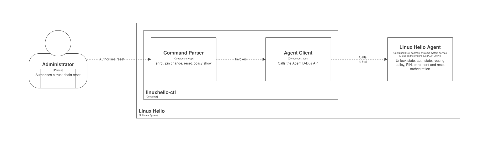
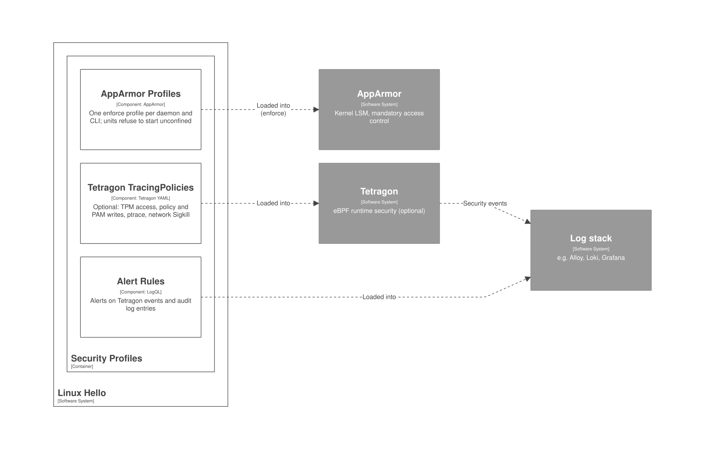

# 5. Building block view

Part of the [Arc42 architecture documentation](README.md). C4 diagrams are defined only in [workspace.dsl](../workspace.dsl) ([ADR-0008](../adr/0008-code-documentation-mapped-to-c4.md)); the images here are rendered from it and are never edited ([how](../diagrams/README.md)). The code names the container or component it implements, and CI checks it against the workspace.

Levels: System Context ([section 3](03-context-and-scope.md)), Container, and one Component view per container. Code level deferred until a Rust skeleton exists. DSL **untested**: validate with the Structurizr CLI before committing.

## 5.1 Level 1: containers

C4 view: `container linuxHello "Containers"` in [workspace.dsl](../workspace.dsl).

| Container | Technology | Responsibility |
| :-- | :-- | :-- |
| Linux Hello Agent | Rust daemon, D-Bus (session) | Unlock state, auth state, routing policy, PIN, enrolment and reset orchestration |
| PAM module `pam_linuxhello` | Rust `cdylib` | Runs face, fingerprint and PIN in parallel; PIN verified against the TPM root key; reports state to the Agent |
| Virtual CTAP Authenticator | Rust daemon with a privileged `uhid` helper ([ADR-0005](../adr/0005-provider-path.md) option B) | Presents Linux Hello to browsers and apps as a USB security key; checks unlock and routing policy; calls the providers |
| TPM Credential Provider | Rust daemon behind the Virtual CTAP Authenticator | Creates and uses device-bound passkeys under the per-user TPM root key |
| KeePassXC Provider Bridge | Rust daemon behind the Virtual CTAP Authenticator | Serves portable passkeys from KeePassXC over its browser protocol |
| Plasma Integration | Rust/cxx-qt, QML, KCM | Prompts, SDDM theme and lock-screen package, camera streams, enrolment, PIN and settings (own settings page next to Users) |
| `linuxhello-ctl` | Rust CLI | Enrol, change PIN, reset trust chain (ADR-0003), inspect policy |
| User Policy | TOML (`~/.config/linuxhello/policy.toml`) | User layer of the policy |
| Admin Policy | TOML (`/etc/linuxhello/policy.d/*.toml`) | Admin layer; locked keys win |
| Security Profiles | AppArmor, Tetragon, alert rules | Confinement and detection shipped with Linux Hello |

Where each container lives in the repository: the path table in [AGENTS.md](https://github.com/LinuxHello/linux-hello/blob/main/AGENTS.md#what-this-is).

## 5.2 Level 2: components

One C4 component view per container in [workspace.dsl](../workspace.dsl):

| View | Container id |
| :-- | :-- |
| `Agent` | `agent` |
| `PAM` | `pamModule` |
| `TPMProvider` | `tpmProvider` |
| `KeePassXCBridge` | `kpxcBridge` |
| `Plasma` | `plasma` |
| `CLI` | `cli` |
| `SecurityProfiles` | `secProfiles` |

### Agent

### PAM

### TPMProvider

### KeePassXCBridge

### Plasma

### CLI

### SecurityProfiles

The components that the user-experience design adds are listed in [section 8, Additions to the C4 model](08-crosscutting-concepts.md#additions-to-the-c4-model).

### What the spikes changed in the model

| Spike | Answer | Change in [workspace.dsl](../workspace.dsl) |
| :-- | :-- | :-- |
| [0005](../spikes/0005-credentialsd-provider-api.md) and [ADR-0005](../adr/0005-provider-path.md) | No provider API in credentialsd; option B chosen | `credentialsd` and `xdg-desktop-portal` removed; new container `ctapHelper` (Virtual CTAP Authenticator) and external system `uhid`; providers are called by it |
| [0008](../spikes/0008-howdy-interface.md) | Howdy: match as a subprocess, enrolment as a root CLI, no preview or detection results | `Face Client` and `Face Enrolment Module` call Howdy as a subprocess; the capture-and-detect component is an open ADR |
| [0009](../spikes/0009-plasma-prompt-component.md) | No slot for a prompt component in the login manager or lock screen; one QML module can be shared | `Greeter and Lock Screen Integration` split into `SDDM Theme` and `Lock Screen Shell Package`, both embedding the shared `Auth Prompt QML Component`; route chosen by ADR |
| [0010](../spikes/0010-kcm-users-extension-point.md) | `kcm_users` has no extension point | `Linux Hello Settings Module` is an own page next to Users; `Users Page Entries` is optional and not planned |
| [0011](../spikes/0011-tpm-root-key-change-auth.md) | Root key authorisation changes in place if the key is a non-primary child | `TPM Key Service` described that way |
| [0012](../spikes/0012-camera-rgb-ir-concurrent.md) | RGB and IR start together unreliably on the BRIO | new component `Camera Stream Owner` |

[ADR-0013](../adr/0013-browser-fallback.md) (proposed) adds an own extension and native-messaging host in front of the broker. It is not modelled: it was written for the own-broker plan and needs revisiting now that stock browsers reach the virtual CTAP authenticator.

## 5.3 Level 3: code

Code level (class diagrams): deferred until the Rust skeleton exists; first candidates are the Routing Policy Engine and the TPM Key Service. Until then every item carries a doc comment ([ADR-0008](../adr/0008-code-documentation-mapped-to-c4.md)).
