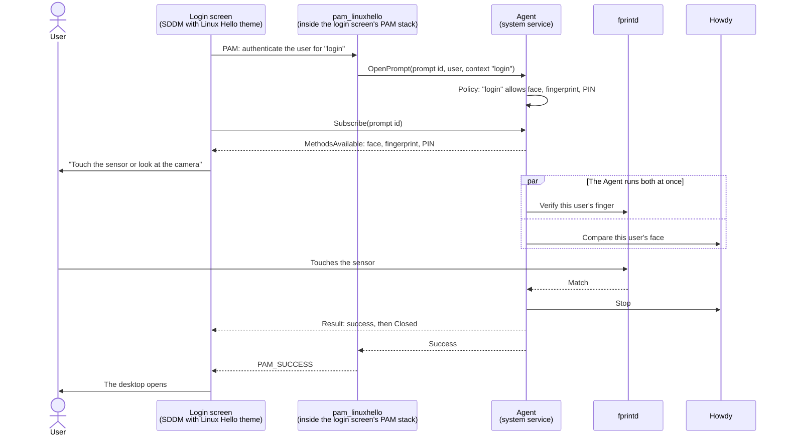
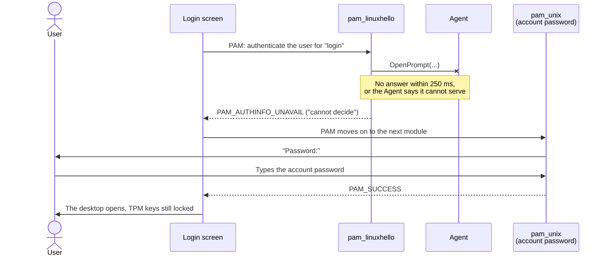
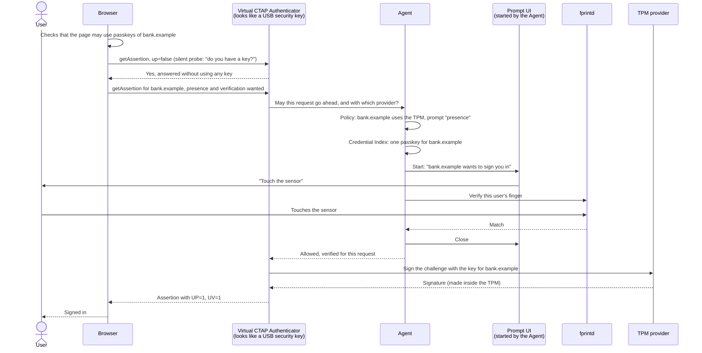
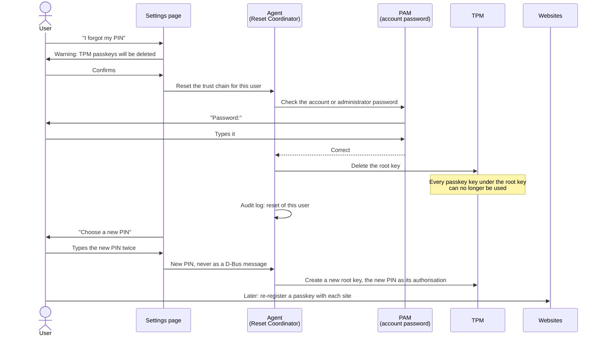

# 6. Runtime view

Part of the [Arc42 architecture documentation](README.md).

[Section 5](05-building-block-view.md) lists the parts of Linux Hello. This section shows them at work: four things a user does, followed step by step through the parts that take part. Each walkthrough starts with what the user sees, then shows a sequence diagram, then explains the steps and what to notice. Terms that may be new to you are in the [glossary](12-glossary.md).

How to read the diagrams: each column is one program, named as in [section 5](05-building-block-view.md). Time runs from top to bottom. A solid arrow is a request, a dashed arrow is the answer. A note across columns explains a step in words.

Linux Hello does not sign anyone in yet (see [what works today](01-introduction-and-goals.md#what-works-today)). Every walkthrough therefore says which steps are built, which are decided but not built, and which are open.

| Walkthrough | What the user does | Main decisions |
| :-- | :-- | :-- |
| [6.1](#61-signing-in-to-the-computer-with-a-fingerprint) | Signs in to the computer with a fingerprint | [ADR-0014](../adr/0014-agent-bus.md), [ADR-0016](../adr/0016-prompt-hosts.md), [ADR-0023](../adr/0023-pam-module-and-login-failure.md) |
| [6.2](#62-signing-in-when-linux-hello-is-not-working) | Signs in while Linux Hello is not working | [ADR-0023](../adr/0023-pam-module-and-login-failure.md) |
| [6.3](#63-signing-in-to-a-website-with-a-passkey) | Signs in to a website with a passkey | [ADR-0005](../adr/0005-provider-path.md), [ADR-0020](../adr/0020-presence-and-verification.md) |
| [6.4](#64-resetting-a-forgotten-pin) | Resets a forgotten PIN | [ADR-0003](../adr/0003-destructive-reset.md) |

## 6.1 Signing in to the computer with a fingerprint

**What the user sees.** The user turns on the computer. The login screen shows their name, a fingerprint symbol with "Touch the sensor", a face symbol with "Look at the camera", and a PIN field. They touch the sensor and the desktop opens. Had they looked at the camera instead, or typed the PIN, the result would be the same: whichever succeeds first wins (requirement UX3 in [section 8](08-crosscutting-concepts.md#requirements)).

**State.** The Agent's calls for opening and following a prompt are built and tested. The PAM module ([linux-hello#196](https://github.com/LinuxHello/linux-hello/issues/196)), the running of fprintd and Howdy by the Agent, and the login-screen theme are decided but not built.

The diagram follows one login at the SDDM login screen. Five programs take part: the login screen with Linux Hello's theme, the PAM module `pam_linuxhello` that the login screen loads, the Agent, and the two programs that check the user, fprintd for fingerprints and Howdy for faces.

Step by step:

1. The login screen asks PAM, the Linux framework every login program uses, to check the user. PAM runs the modules listed for the login screen; the first is `pam_linuxhello`.
2. The module opens a *prompt* at the Agent: a short-lived record of one sign-in attempt, named by an identifier that the module and the login screen can both work out on their own ([ADR-0014](../adr/0014-agent-bus.md)). The module has 250 milliseconds to reach the Agent.
3. The Agent asks its policy which methods the `login` context allows. By default that is the face, the fingerprint and the PIN.
4. The login screen subscribes to the prompt and hears which methods are available and which are running. It shows them; it does not take part in the decision.
5. The Agent's Method Orchestrator starts fprintd and Howdy at the same time, and the PIN field stays ready.
6. fprintd reports a match to the Agent. The Agent stops Howdy, tells the login screen the prompt succeeded and is closed, and answers the module.
7. The module returns `PAM_SUCCESS`, and the login screen starts the session.

**What to notice.**

- **The PAM module only asks.** It runs no method itself and starts no thread or program inside the login screen ([ADR-0023](../adr/0023-pam-module-and-login-failure.md)). Everything that can hang or crash runs in the Agent, which is confined and restarted by systemd if it fails.
- **The indicator is only for the user's eyes.** The login screen shows what the Agent tells it, but the decision is made by the Agent from what fprintd and Howdy report. A program of the same user that disturbs the indicator can make it show the wrong state; it cannot change the result ([ADR-0014](../adr/0014-agent-bus.md), amendment of 2026-11-16).
- **A PIN does not travel on the bus.** Had the user typed the PIN, the PAM module would have passed it to the Agent over the Agent's [PIN socket](12-glossary.md#pin-socket), never as a D-Bus message, and only the TPM would have checked it ([ADR-0021](../adr/0021-pin-transport.md)).
- **Open:** whether this login also unlocks the user's keys in the TPM, and how a fingerprint match could be tied to the TPM at all, is not decided ([linux-hello#136](https://github.com/LinuxHello/linux-hello/issues/136)).
- **Other places.** `sudo` and the text console work the same way. The lock screen on Plasma 6.8 and later shows KDE's own face and fingerprint services instead of Linux Hello's prompt, so there the methods do not run in one prompt ([ADR-0016](../adr/0016-prompt-hosts.md)).

## 6.2 Signing in when Linux Hello is not working

**What the user sees.** Something is wrong: the Agent has crashed, its AppArmor profile is not loaded, or the TPM is locked. The login screen asks for the account password, the user types it, and the desktop opens. Passkeys that live in the TPM stay locked until Linux Hello works again.

**State.** The PAM configuration snippets that put the password module `pam_unix` after `pam_linuxhello` for login, unlock and `sudo` are built ([linux-hello#197](https://github.com/LinuxHello/linux-hello/issues/197)). The module with its deadline ([linux-hello#196](https://github.com/LinuxHello/linux-hello/issues/196)) and the test runs in a virtual machine ([linux-hello#198](https://github.com/LinuxHello/linux-hello/issues/198)) are not built yet.

The diagram shows the PAM stack of the login screen: first Linux Hello's module, then `pam_unix`, the standard module that checks the account password.

Step by step:

1. The module tries to reach the Agent. Either nothing answers within 250 milliseconds, or the Agent answers that it cannot serve: its profile is not enforcing, the TPM is locked, or the policy leaves the `login` context unsatisfiable.
2. The module answers `PAM_AUTHINFO_UNAVAIL`, which means "I cannot decide". It never answers success in this case (property P-20 in the [security properties](https://github.com/LinuxHello/linux-hello/blob/main/docs/security/properties.md)).
3. PAM moves on to `pam_unix`, which asks for and checks the account password.
4. The session starts. The password never unlocks keys in the TPM, so passkeys stored there cannot be used until the user verifies with Linux Hello.

**What to notice.**

- **Why "cannot decide" and not "no".** If the module answered "no", a crashed Agent would lock every user out of their own computer. Availability at login is quality goal 2 in [section 1.3](01-introduction-and-goals.md#13-quality-goals).
- **The price.** While Linux Hello is down, the password alone logs the user in, even in a context whose policy asks for two factors. This is a recorded risk in [section 11](11-risks-and-technical-debt.md).
- **The same holds while the Agent restarts.** systemd restarts a failed Agent within a second, and the clients follow [one rule after a restart](https://github.com/LinuxHello/linux-hello/blob/main/docs/architecture/agent-restart.md); a login that falls into that gap falls through to the password.

## 6.3 Signing in to a website with a passkey

**What the user sees.** The user is logged in and opens `https://bank.example` in Firefox, which offers "Sign in with a passkey". A small Linux Hello window appears, outside the browser: "bank.example wants to sign you in. Touch the sensor." They touch it and are signed in. If they had two accounts at the bank, the window would first ask which one.

**State.** The path through a virtual security key worked end to end in experiments, with stock Firefox and Chromium and a software TPM ([spike 0094](../spikes/0094-virtual-ctap-end-to-end.md), [spike 0120](../spikes/0120-resident-keys-presence-and-uv.md)). The rules for presence and verification are decided ([ADR-0020](../adr/0020-presence-and-verification.md)). The Virtual CTAP Authenticator, the TPM provider and the Prompt UI are not built ([linux-hello#175](https://github.com/LinuxHello/linux-hello/issues/175)). Open: how the Agent knows the prompt window is its own ([linux-hello#177](https://github.com/LinuxHello/linux-hello/issues/177)), and whose keys the virtual key serves when two users are logged in ([linux-hello#138](https://github.com/LinuxHello/linux-hello/issues/138)).

The diagram follows one sign-in. The browser talks to Linux Hello as if it were a USB security key; behind that key, the Agent decides, the Prompt UI asks the user, and the TPM provider signs.

Step by step:

1. The web page asks the browser for a passkey through [WebAuthn](12-glossary.md#webauthn). The browser checks that the page's [origin](12-glossary.md#origin) may use passkeys of `bank.example`; Linux Hello relies on the browser for that check.
2. Before the real request, browsers often send a silent probe ([`up=false`](12-glossary.md#user-presence-up)) to learn whether a passkey exists. Linux Hello answers it without touching any key and without asking the user, so the user sees one prompt and the key signs once.
3. The real request reaches the Virtual CTAP Authenticator in [CTAP2](12-glossary.md#ctap-ctap2), the language of security keys. It asks the Agent whether the request may go ahead.
4. The Agent's policy says which [provider](12-glossary.md#provider) holds passkeys for this site and how strongly to ask. Its [Credential Index](12-glossary.md#credential-index) says which passkeys exist for the site.
5. The Agent starts the [Prompt UI](12-glossary.md#prompt-ui) as its own confined child process. The window shows the site's name taken from the request and the account names from the Credential Index, never text the website sent.
6. The user touches the sensor. fprintd reports the match to the Agent, not to the window: the window only shows; it decides nothing.
7. The Agent tells the authenticator the request is allowed and that the user was verified just now. The TPM provider has the TPM sign with this site's key. The key's authorisation is bound to the site, so the TPM itself would refuse to sign for another site ([spike 0119](../spikes/0119-rp-bound-credential-keys.md)).
8. The browser receives the signature with the flags "user present" (UP) and "user verified" (UV) and passes it to the website.

**What to notice.**

- **Nothing is signed silently.** Every request needs a [presence gesture](12-glossary.md#presence-gesture) that another program of the same user cannot fake: a fingerprint match, or the PIN checked by the TPM. A click on the window is not enough when the machine has a sensor ([ADR-0020](../adr/0020-presence-and-verification.md)).
- **"Verified" means recently verified.** The website is told UV=1 only if the user was verified for this request or at most 60 seconds before it. Being logged in to the desktop does not count ([verification window](12-glossary.md#verification-window)).
- **The browser needs no change.** It sees a USB security key, which every browser supports. The price is that it shows "security key" and not "this device" ([ADR-0005](../adr/0005-provider-path.md)).
- **With KeePassXC.** If the policy puts the site's passkeys in KeePassXC instead, the KeePassXC provider signs in step 7 and everything else stays the same.

## 6.4 Resetting a forgotten PIN

**What the user sees.** The user has forgotten their PIN. In Linux Hello's settings page they choose "I forgot my PIN". A warning says that every passkey kept in the TPM will be deleted and must be registered again with each website. They confirm, type their account password, choose a new PIN, and can use fingerprint, face and PIN again. Then, site by site, they register new passkeys, using each website's account recovery or a second passkey they registered earlier.

**State.** Decided ([ADR-0003](../adr/0003-destructive-reset.md)), not built. The Reset Coordinator in the Agent and the reset command of `linuxhello-ctl` are in the C4 model. The administrator can authorise the same reset with the administrator's password.

The diagram shows the reset from the settings page; `linuxhello-ctl reset` takes the same path.

Step by step:

1. The settings page warns before anything happens, because the reset cannot be undone.
2. The Agent's Reset Coordinator has PAM check the account password, or the administrator's. The password authorises the reset and nothing else: it never unlocks a key.
3. The Agent deletes the user's [root key](12-glossary.md#root-key) in the TPM. Every device-bound passkey was created under it, so all of them become unusable at once. The audit log records the reset.
4. The user chooses a new PIN. Like every PIN, it reaches the Agent outside D-Bus messages ([ADR-0021](../adr/0021-pin-transport.md)), and the TPM creates a new root key with it as the authorisation.
5. Recovery happens at the websites, one by one: the user signs in there another way and registers a new passkey.

**What to notice.**

- **Why there is no recovery key.** A recovery key would need a second way into the root key, so the root key would have to be created outside the TPM or be copyable, which weakens it. Windows Hello's default reset works the same way ([ADR-0003](../adr/0003-destructive-reset.md)).
- **What survives.** Passkeys kept in KeePassXC are not in the TPM and are not touched. For each important account the user should therefore register a second passkey, in KeePassXC or on a hardware security key, before they ever need a reset.
- **Changing a known PIN is different.** Changing the PIN while the user still knows it changes the root key's authorisation in place, and every passkey survives ([spike 0011](../spikes/0011-tpm-root-key-change-auth.md)).

## Other journeys

These have no walkthrough yet; each will get one when its parts are decided in more detail.

- **Creating a passkey.** A website offers to create a passkey. The policy for that site, or the user, chooses whether it is kept in the TPM (device-bound) or in KeePassXC (portable). For high-value accounts Linux Hello suggests registering a second passkey as well, so that a reset (6.4) does not lock the user out of that account.
- **A desktop app signs in again.** When a desktop or Electron app's login expires, it opens the service's login page in a browser, and that page asks for a passkey as in 6.3: one touch of the sensor. The new login token is kept in the [Secret Service](12-glossary.md#secret-service). The aim is to remove even that touch, with [DBSC](12-glossary.md#dbsc) ([section 4](04-solution-strategy.md#token-reissue-the-claude-desktop-case)).
