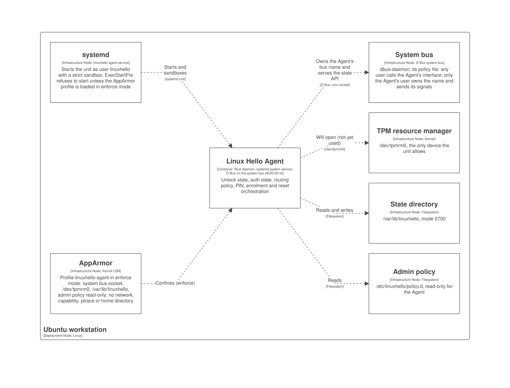

# 7. Deployment view

Part of the [Arc42 architecture documentation](README.md). C4 diagrams are defined only in [workspace.dsl](../workspace.dsl) ([ADR-0008](../adr/0008-code-documentation-mapped-to-c4.md)); the image here is rendered from it and is never edited ([how](../diagrams/README.md)).

Only the Agent is deployed so far. The PAM module, the providers, the virtual CTAP authenticator and the Plasma pieces have no unit or package yet, so they are not in the deployment view.

## 7.1 Infrastructure level 1: the Agent on a workstation

C4 view: `deployment linuxHello "Workstation"` in [workspace.dsl](../workspace.dsl).

The Agent is one systemd system service for all users on the system bus ([ADR-0014](../adr/0014-agent-bus.md)). The files come from `security/` and `crates/linuxhello-agent` of the code repository:

| Artefact | Source in `linux-hello` | Installed at |
| :-- | :-- | :-- |
| Agent binary | `crates/linuxhello-agent` | `/usr/libexec/linuxhello/linuxhello-agent` |
| systemd unit | `security/systemd/linuxhello-agent.service` | `/usr/lib/systemd/system/linuxhello-agent.service` |
| User and group `linuxhello`, member of `tss` | `security/systemd/linuxhello.sysusers` | `/usr/lib/sysusers.d/linuxhello.conf` |
| System-bus policy | `security/dbus/io.github.LinuxHello.Agent1.conf` | `/usr/share/dbus-1/system.d/io.github.LinuxHello.Agent1.conf` |
| AppArmor profile `linuxhello-agent` | `security/apparmor/linuxhello-agent` | `/etc/apparmor.d/linuxhello-agent` |
| State (root-key blobs, prompt data) | created by the unit (`StateDirectory`) | `/var/lib/linuxhello`, mode 0700 |
| Admin policy layer | written by the administrator | `/etc/linuxhello/policy.d/`, read-only for the Agent |

## 7.2 How it starts, and what stops it

- The unit runs as the user `linuxhello` with no capability, a strict sandbox, no network but the system bus socket, and `/dev/tpmrm0` as its only device ([section 8, Security hardening](08-crosscutting-concepts.md#security-hardening)).
- It **fails closed**: `ExecStartPre` demands that the profile is loaded in enforce mode, so the unit does not start with the profile in complain mode or not loaded.
- Two independent layers decide who may do what on the bus: the bus policy (only the Agent's user owns the name or sends its signals; any user calls its interface; its properties and every other interface are denied) and AppArmor (the Agent's own permissions).

## 7.3 What has been tested

The files were installed as above in a test VM and exercised on a real system bus with real users, on **Ubuntu 24.04** (kernel 6.8) and **Ubuntu 26.04** (kernel 7.0, AppArmor 5, systemd 259). Each run makes 22 checks and all passed on both: the unit starts only with the profile enforcing and refuses to start otherwise; the name is owned by the Agent's user, which runs confined; any user reaches the methods and nobody reads the properties; another user is refused on a prompt it did not open and cannot take the name; a subscriber hears the Agent's signal, a bystander and two forgers cause nothing; the profile denies what it does not grant; AppArmor denies nothing the Agent needs. The systemd exposure score is 0.5 (SAFE). The run is a script in the maintainer's workstation repository, by hand, not a CI job.

The run found one defect that no unit test could: under systemd's mount namespace AppArmor sees the bus socket path without its leading slash and denied the connect, so the profile needs `flags=(attach_disconnected)`.

## 7.4 Not yet covered

- **Other containers.** The PAM module, TPM provider, KeePassXC bridge, virtual CTAP authenticator (with its privileged `uhid` helper) and Plasma pieces need units, packages and profiles of their own; the AppArmor profile and bus policy of each are still to be written.
- **The TPM.** The Agent allows `/dev/tpmrm0` but does not use it yet. Only a software TPM was tried.
- **The user layer of the routing policy** is decided ([ADR-0018](../adr/0018-user-policy-layer.md)): the Agent keeps it in its state directory and users set it over D-Bus, so the unit and profile need no access to home directories. The state store and the two methods (`GetUserPolicy`, `SetUserPolicy`) are not built yet.
- **Platforms.** Only Ubuntu was tested. Which distributions Linux Hello supports is not decided, and with it whether a policy other than AppArmor is needed (Fedora uses SELinux).
- **Packaging and updates.** Nothing builds a `.deb` or installs these files automatically; the paths above are the ones the files name in their headers.
- How releases are built and attested: [ADR-0006](../adr/0006-attested-quality-gates-and-releases.md).
