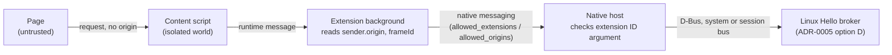

# Spike: own browser extension in front of the broker

## Question

Issue [#33](https://github.com/LinuxHello/linux-hello/issues/33) adds a third 1.0 browser fallback: a Linux Hello web extension that reaches the ADR-0005 broker through a native-messaging host. Two assumptions decide whether it is viable:

1. **Origin.** Can the extension get the requesting origin from the browser rather than the page, in both Firefox and Chromium, and can the native host refuse every caller except that extension?
2. **Confined browsers.** Can a Firefox shipped as a Snap or Flatpak start our native-messaging host on KDE Plasma?

## Time box

2 working days proposed. This note covers a source and documentation read (under one day). The run on Plasma is not done; see Method.

## Method

Read the browser extension documentation and upstream source at the refs below (2026-11-07):

| Project | Ref | Version |
| :-- | :-- | :-- |
| Firefox (`mozilla-firefox/firefox`) | `main` at `db547b6` | 162.0a1 (`browser/config/version.txt`) |
| `flatpak/xdg-desktop-portal` | PRs #705 and #1537; releases to 1.22.1 | 1.22.1 |
| `flatpak/xdg-native-messaging-proxy` | latest release | 0.1.0 |
| MDN and Chrome extension reference | live pages | — |

```sh
# Firefox: how native messaging picks the portal or the proxy, and the pref defaults
B=https://raw.githubusercontent.com/mozilla-firefox/firefox/db547b61903f9dee2ddb1a86de3beeab88b2c923
curl -sS $B/toolkit/components/extensions/docs/native-messaging-portal-design.md
curl -sS $B/toolkit/components/extensions/NativeMessaging.sys.mjs | grep -n -i -E "proxy|portal|arguments"
curl -sS $B/widget/gtk/WidgetUtilsGtk.cpp | grep -n -A25 "bool ShouldUsePortal"
curl -sS $B/modules/libpref/init/StaticPrefList.yaml | grep -n -A3 "use-xdg-desktop-portal.native-messaging"

# Upstream portal: was the WebExtensions portal merged, and what replaced it
gh pr view 705  --repo flatpak/xdg-desktop-portal --json state,mergedAt,closedAt
gh pr view 1537 --repo flatpak/xdg-desktop-portal --json state,mergedAt,closedAt,comments
gh release list --repo flatpak/xdg-native-messaging-proxy
gh api repos/flatpak/xdg-native-messaging-proxy/readme --jq .content | base64 -d
```

All commands: **tested** (run against GitHub and raw source; no browser run).

**Not done, so untested:**

- A prototype extension and native host. Nothing in this note has been run in a browser.
- Snap or Flatpak Firefox on Plasma, with either the portal or the proxy.
- Chromium in any confined package (Snap or Flatpak). Not read.
- Which pref values the Firefox Snap and Flatpak packages ship. Not read.

## Evidence

1. **The browser reports the sender's origin.** `runtime.MessageSender.origin` is "the origin of the page or frame that opened the connection" in Chrome (since 80) and in Firefox (MDN). `frameId` and `documentId` (Chrome 106+) identify the frame. The page sets none of these. Both references note that `origin` can differ from `url` (for example `about:blank`) or be opaque (sandboxed iframes). So the extension must reject opaque origins and must use `origin`, not `url`.
2. **The native host learns which extension started it.** The browser passes this as an argument when it starts the host. Firefox passes the host manifest path and the extension ID (Firefox 55+; `NativeMessaging.sys.mjs` builds `arguments: [hostInfo.path, context.extension.id]`). Chrome on Linux passes the origin `chrome-extension://<id>/`. The host manifest limits which extensions may start it: `allowed_extensions` (add-on IDs) in Firefox, `allowed_origins` (`chrome-extension://` URLs) in Chrome. The browser enforces this list. The argument comes from the browser, so it is only as trustworthy as whatever started the host.
3. **The WebExtensions portal never reached a release.** xdg-desktop-portal PR #705 closed unmerged on 2025-03-25; its continuation #1537 closed unmerged on 2025-07-28. Ubuntu has shipped #705 as a distribution patch since 22.04 (Firefox design note, evidence 4).
4. **Upstream replaced it with a separate proxy, flagged as insecure.** `flatpak/xdg-native-messaging-proxy` (release 0.1.0, 2025-03-26) holds the same code under its own D-Bus name, outside the portal. Its README says exposing native hosts to a sandboxed process is "potentially *INSECURE*": any host may offer a sandbox escape. A sandboxed application needs explicit talk permission to the proxy's name. The Firefox design note says the proxy has no user prompt and "is currently available in the Ubuntu 26.04". The portal patch prompted once per extension and host.
5. **Firefox supports both, off by default upstream.** At `db547b6`, `NativeMessaging.sys.mjs` tries the proxy first and falls back to the portal. The prefs `widget.use-xdg-desktop-portal.native-messaging` and `widget.use-xdg-desktop-portal.native-messaging-proxy` both default to `0` (off) in `StaticPrefList.yaml`. With `2`, Firefox uses them only when running in a Snap or Flatpak (`ShouldUsePortal`). The confined packages must set the prefs themselves. Mozilla bug [1940050](https://bugzilla.mozilla.org/show_bug.cgi?id=1940050) shows that Thunderbird's Snap did so in its 135 betas. Earlier, Firefox 133's Snap broke KeePassXC-Browser until the pref was set (bug [1930119](https://bugzilla.mozilla.org/show_bug.cgi?id=1930119)).
6. **Under confinement the proxy or portal starts the host, not the browser.** The Firefox design note makes the host system responsible for making sure "the native messaging manifests and referenced applications cannot be modified by the confined browser". It does not say who supplies the extension-ID argument when the proxy starts the host. That is the argument evidence 2 relies on.

## Answer

**Partly** (from a source read; the Plasma run is still open).

**Origin: yes, by design.** The extension can make the origin browser-supplied end to end:



- The page-world shim sends only the WebAuthn options. The background script takes the origin from `sender.origin`. It rejects opaque origins and checks that `sender.frameId` and the tab's top-level origin match what the request claims.
- The host manifest lists only our extension. The host also checks the extension ID argument (evidence 2).
- The broker accepts only the native host. How it authenticates the host (peer credentials, executable path) is not decided here.
- This answers the first "Done when" item in #33. A native-messaging helper cannot establish the origin by itself. The browser establishes it, the extension carries it, and the page never supplies it. The credentialsd extension gets this wrong (spike [0006](0006-browser-webauthn-portal.md), evidence 5).

**Confined Firefox: only with distribution help, and untested on Plasma.**

- Upstream has no release of a portal for this (evidence 3). The supported path is `xdg-native-messaging-proxy` (evidence 4). It must be installed on the host, the browser must have permission to talk to it, and the browser's pref must be set (evidence 5).
- On Kubuntu this depends on what Ubuntu ships (portal patch or proxy) and on the Firefox Snap's pref. Neither depends on the desktop, but this is **not tested** on Plasma.
- The proxy has no per-extension prompt and exposes every host on the system to any sandboxed app allowed to talk to it (evidence 4). With the proxy in use, the extension-ID check in the native host may be our only guard. Whether that argument can be trusted there is open (evidence 6).

What this changes:

- The own-extension option in #33 stays viable. The origin-trust issue is solved by design, not by upstream work.
- The fallback ADR must state a supported-browser matrix. Unconfined Firefox and Chromium work by design. Snap and Flatpak Firefox depend on the proxy or the Ubuntu portal patch.
- The broker must not trust the native host more than the extension-ID check justifies. Whether that is enough under the proxy depends on evidence 6; if not, add a check of our own (for example, the broker confirms the request with the user in its prompt).

Still open (the hands-on part of this spike):

- Prototype: extension plus native host, against webauthn.io, in unconfined Firefox and Chromium on Plasma.
- The same in the Firefox Snap on Kubuntu: which mechanism is used (portal or proxy), whether a prompt appears, and what extension ID the host receives.
- Flatpak Firefox: what permissions are needed (`--talk-name` for the proxy, `flatpak permission-set webextensions` for the portal).
- Chromium in a Snap or Flatpak: not read.
