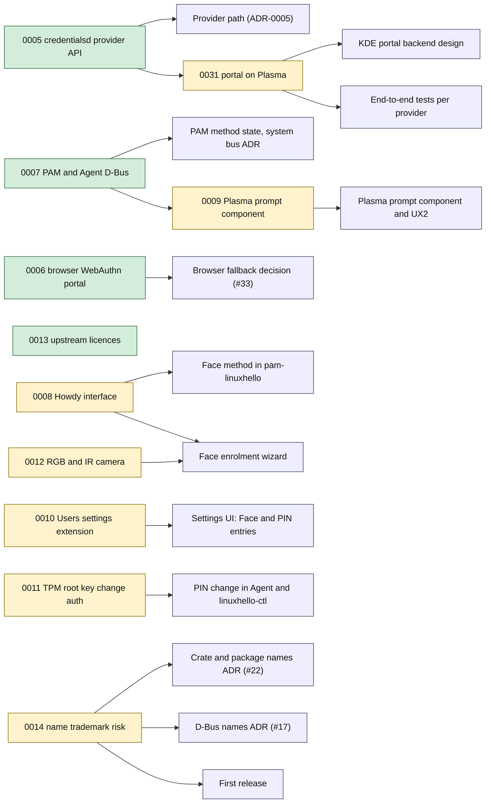

# Spikes

| Spike | Answer | Issue |
| :-- | :-- | :-- |
| [0005: credentialsd provider API and portal on KDE Plasma](0005-credentialsd-provider-api.md) | No, not at v0.3.1; see [ADR-0005](../adr/0005-provider-path.md) | [#5](https://github.com/LinuxHello/linux-hello/issues/5) |
| [0006: Browser WebAuthn through the portal (Firefox, Chromium)](0006-browser-webauthn-portal.md) | Partly: no stock browser calls the portal; only add-ons and an experimental Firefox build | [#6](https://github.com/LinuxHello/linux-hello/issues/6) |
| [0007: PAM module publishes method state over the Agent's D-Bus API](0007-pam-dbus-method-state.md) | Partly: only the system bus is reachable in every PAM context; the Agent must serve the PAM module there (needs an ADR) | [#7](https://github.com/LinuxHello/linux-hello/issues/7) |
| [0013: Licences of libwebauthn, KeePassXC, fprintd and Howdy](0013-upstream-licences.md) | Yes: all fit C2 and C3 | [#13](https://github.com/LinuxHello/linux-hello/issues/13) |
| [0008: Howdy interface for live preview, enrolment and test](0008-howdy-interface.md) | Open | [#8](https://github.com/LinuxHello/linux-hello/issues/8) |
| [0009: Third-party prompt in the Plasma login manager and kscreenlocker](0009-plasma-prompt-component.md) | Open | [#9](https://github.com/LinuxHello/linux-hello/issues/9) |
| [0010: Extension point in KDE's Users settings module](0010-kcm-users-extension-point.md) | Open | [#10](https://github.com/LinuxHello/linux-hello/issues/10) |
| [0011: Change the TPM root key's authorisation in place with tss-esapi](0011-tpm-root-key-change-auth.md) | Open | [#11](https://github.com/LinuxHello/linux-hello/issues/11) |
| [0012: Camera streams RGB and IR at the same time](0012-camera-rgb-ir-concurrent.md) | Open | [#12](https://github.com/LinuxHello/linux-hello/issues/12) |
| [0014: Trademark risk of the name Linux Hello](0014-name-trademark-risk.md) | Open | [#14](https://github.com/LinuxHello/linux-hello/issues/14) |
| [0031: credentialsd with the patched portal and its GTK backend on Plasma](0031-credentialsd-portal-on-plasma.md) | Open | [#31](https://github.com/LinuxHello/linux-hello/issues/31) |

New spikes start from [the template](../templates/spike.md). See [index](../README.md).

## What blocks what

An arrow means the spike's answer is needed before the target can be designed or built. Green spikes are answered, amber are open. Targets are containers or features from the [building block view](../arc42/05-building-block-view.md).

Edges come from the *Blocks* and *Why it matters* sections of the issues, plus the follow-up links in [0009](0009-plasma-prompt-component.md) and [0031](0031-credentialsd-portal-on-plasma.md). Spike 0013 blocks nothing open: it settled the licence boundaries.
